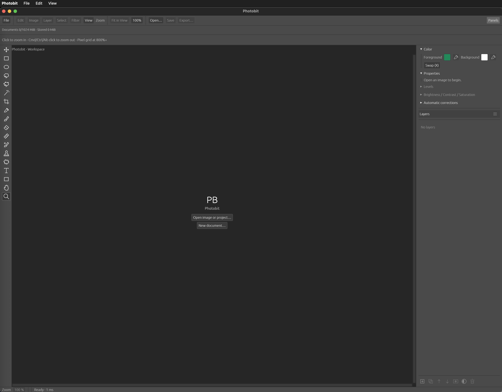

# Photobit

Photobit is a lightweight desktop image editor for photos, layers, text, and effects. Edit locally, keep your files on your computer, and skip the subscription.

I built Photobit because I was tired of paying high fees for a bloated image editor I only used occasionally. I didn’t need it every day, but when I needed it, I needed it.

This repository provides compiled Photobit downloads and release notes. It's currently in Alpha.

## Features

- Layers, blend modes, opacity, and layer masks.
- Brush, Eraser, Spot Healing, Healing Brush, Clone Stamp, and Patch tools.
- Rectangular and Elliptical Marquee, Lasso, Polygonal Lasso, and Magic Wand selections.
- Editable text, layer effects, Gaussian Blur, and Unsharp Mask.
- Levels, brightness, contrast, saturation, and automatic color corrections.
- Crop, resize, rotate, and transform tools with undo/redo.
- Open PNG, JPEG, and WebP images; export PNG or JPEG.
- Save editable projects as `.photoworks` files.

## Download and install

The current release requires **macOS 13 Ventura or later** and an **Apple Silicon Mac (M1 or later)**.

1. Open the **Releases** section of this repository.
2. Download **Photobit-darwin-arm64.zip** from the latest release's **Assets** section.
3. Double-click the ZIP to extract it.
4. Drag **Photobit.app** into your **Applications** folder, then open it.

## Windows and Linux

If you'd like a **Windows or Linux version**, open an issue in this repository and let me know which system you use. I can set up builds if there's interest. For Linux, please include your distribution and CPU architecture.

## First launch on macOS

Photobit is distributed without Apple Developer ID signing or notarization. macOS may block the first launch because it cannot verify the developer or check the app for malicious software.

If you downloaded Photobit from this repository's Releases and trust the download:

1. Try opening **Photobit** from **Applications**.
2. Dismiss the warning.
3. Open **Apple menu → System Settings → Privacy & Security**.
4. Scroll to **Security** and find the message about Photobit being blocked.
5. Click **Open Anyway**, then **Open** in the confirmation prompt. Authenticate if asked.

macOS saves an exception for the app, so you can open it normally afterward. These steps follow [Apple's instructions for opening apps from unidentified developers](https://support.apple.com/en-us/102445).

If macOS reports that the app is damaged or will harm your computer, stop and download a fresh copy from Releases or report the issue. On a managed Mac, your administrator may need to approve installation.

## Getting started

Open an image, select a layer, and choose a tool from the left toolbar. Import additional images as layers to combine them.

Use **Save** to keep your editable layers in a `.photoworks` project. Use **Export As** to create a PNG or JPEG for sharing.

## Feedback

Report problems in this repository's **Issues** section. Include your Photobit version, operating system version, computer model, and steps to reproduce the problem. Screenshots are helpful.
